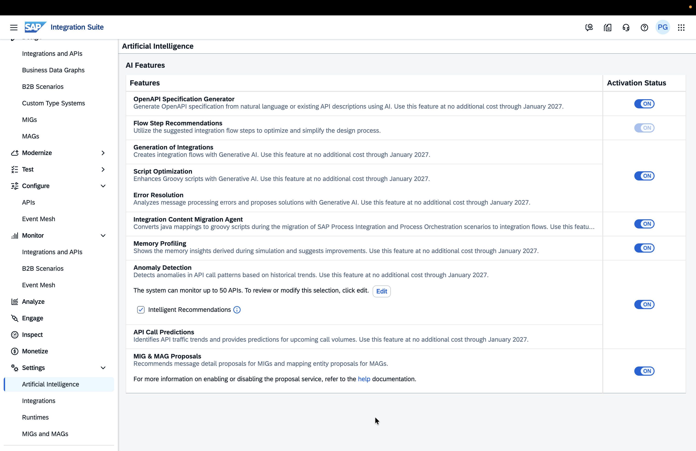

# IN262 — Build an Integration Scenario from Scratch with AI Assistance at Every Step

## About This Session

This hands-on workshop gives you practical experience with the **AI capabilities built into SAP Integration Suite** — from design time to runtime. In 2 hours you will work through the full lifecycle of an enterprise integration: generating flows, profiling and optimising scripts, resolving errors, exposing APIs as MCP tools, and running the scenario end-to-end via an AI agent.

> [!NOTE]
> All AI features in this session are available in SAP Integration Suite and can be enabled from the **Settings** page.
>
>  


---

## 1. Business Scenario — Campaign Management

### The Story

**Best Run Business** sells products across multiple markets and runs personalised campaigns for product launches and seasonal promotions. Today, campaign preparation is manual — product master data is created by hand, discount calculations are done in spreadsheets, and campaign offers are sent without personalisation. This takes days and is error-prone.

**The goal:** automate the entire journey — from product creation to a personalised campaign offer landing in the customer's inbox — using AI-assisted integration on SAP Integration Suite.

### Who Does What

| Persona | What they do in this session |
|---|---|
| **Integration Developer / API Developer** | Builds the integration scenario using AI — generates the iFlow, optimises and profiles scripts, resolves runtime errors, creates the API artifact, and configures the MCP Server |
| **Product Master Data Steward** | Uses an AI agent to create a new product in S/4HANA by describing it in plain language — no API client, no manual payload |
| **End User / Customer** | Receives a personalised campaign offer in their task inbox, reviews the discount, and places the order |

### How It Works — End-to-End

```
[Data Steward]  describes new product in plain language to AI agent
      ↓
[AI Agent]      calls S/4HANA product creation API via MCP Server
      ↓
[S/4HANA]       product created → AEM event raised automatically
      ↓
[Integration Suite]  picks up event → calculates personalised discount
                     based on customer purchase history → triggers campaign
      ↓
[Customer]      receives campaign offer task in SAP Build Process Automation inbox
      ↓
[Customer]      reviews offer, places order
      ↓
[System]        Sales Order confirmed in S/4HANA → confirmation sent to inbox
```

---

## 2. AI Capabilities You Will Use

SAP Integration Suite embeds AI at every stage of the integration lifecycle. In this session you will use **five distinct AI capabilities**:

| # | AI Capability | What you will do |
|---|---|---|
| 1 | **AI-assisted iFlow Generation** | Generate a complete integration flow from a plain-language description |
| 2 | **AI Script Optimisation** | Detect and fix code issues in a Groovy script — static analysis, then again enriched with runtime profiling data |
| 3 | **AI Memory Profiling** | Run the flow in the Simulator, measure per-step heap allocation, and identify the memory bottleneck |
| 4 | **AI Error Resolution** | Trigger a real runtime error and use AI to diagnose and fix it |
| 5 | **MCP Server + AI Agent** | Expose the S/4HANA product API as an MCP tool and call it from Claude Code CLI using natural language |

---

## 3. System Landscape

| System | Role |
|---|---|
| **SAP Integration Suite** | Design, build, deploy, and monitor integration flows; host MCP Server |
| **SAP S/4HANA (on-premise)** | Product master data system — source of product creation events |
| **SAP Build Process Automation** | Campaign offer task inbox and Sales Order confirmation |
| **Claude Code CLI** | AI agent on participant laptops — connects to the MCP Server |

> [!NOTE]
> All systems are pre-configured and seeded with data by the session organisers. You do not need to perform any system setup.

---

## 4. Exercises

| | Exercise | Type | Duration |
|---|---|---|---|
| 0 | Welcome, Business Scenario & Technical Overview | Instructor-led | 10 min |
| 1 | [Generate, Profile, Optimise and Deploy the Integration Flow with AI](exercises/ex1/README.md) | Hands-on | 30 min |
| | → [Exercise 1.1 — Generate the iFlow with AI](exercises/ex1/ex1-1/README.md) | | |
| | → [Exercise 1.2 — Memory Profiling and Script Optimisation](exercises/ex1/ex1-2/README.md) | | |
| 2 | [Test Run the Scenario and Resolve Errors with AI](exercises/ex2/README.md) | Hands-on | 10 min |
| 3 | [Create MCP Server and Expose the API](exercises/ex3/README.md) | Hands-on | 20 min |
| 4 | [End-to-End: Create a Product and Trigger the Campaign](exercises/ex4/README.md) | Hands-on | 20 min |
| 5 | Wrap-up, Q&A & Key Takeaways | Instructor-led | 10 min |


## Contributing
Please read the [CONTRIBUTING.md](./CONTRIBUTING.md) to understand the contribution guidelines.

## Code of Conduct
Please read the [SAP Open Source Code of Conduct](https://github.com/SAP-samples/.github/blob/main/CODE_OF_CONDUCT.md).

## How to obtain support

Support for the content in this repository is available during the actual time of the online session for which this content has been designed. Otherwise, you may request support via the [Issues](../../issues) tab.

## License
Copyright (20xx-)20xx SAP SE or an SAP affiliate company and <your-project> contributors. Please see our [LICENSE](LICENSE) for copyright and license information. Detailed information including third-party components and their licensing/copyright information is available [via the REUSE tool](https://api.reuse.software/info/github.com/SAP/<your-project>).
