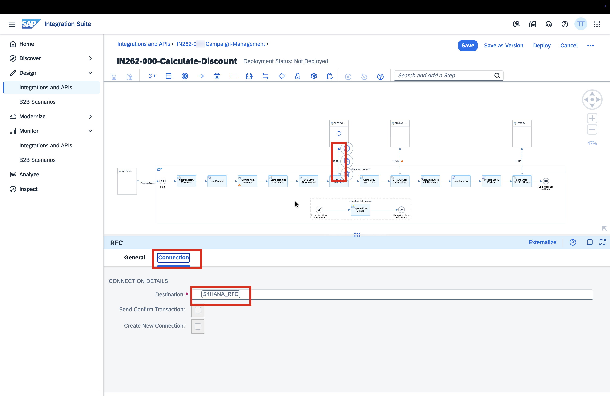
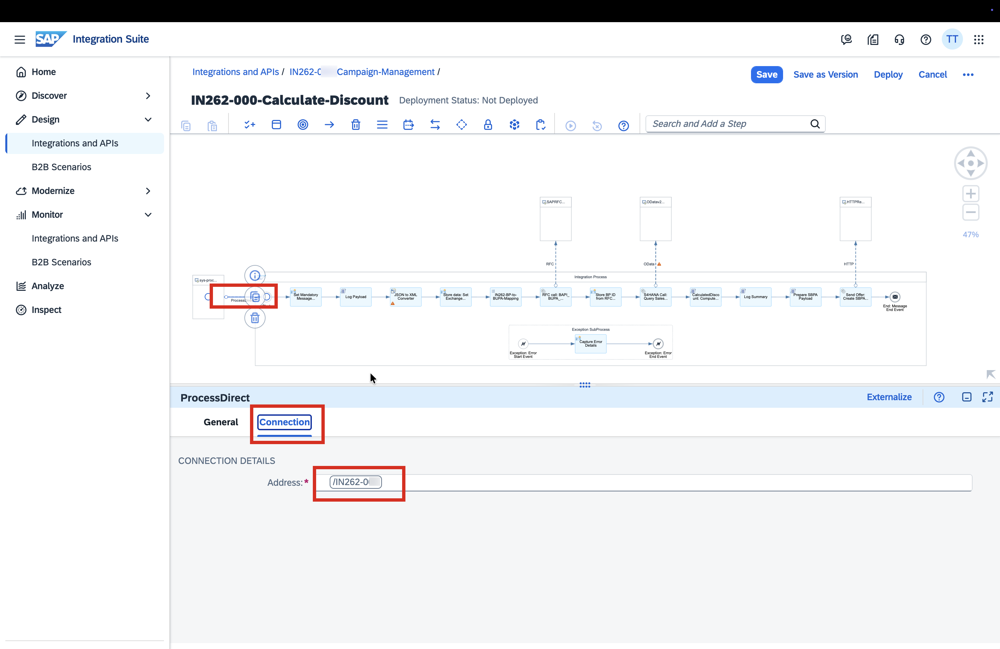
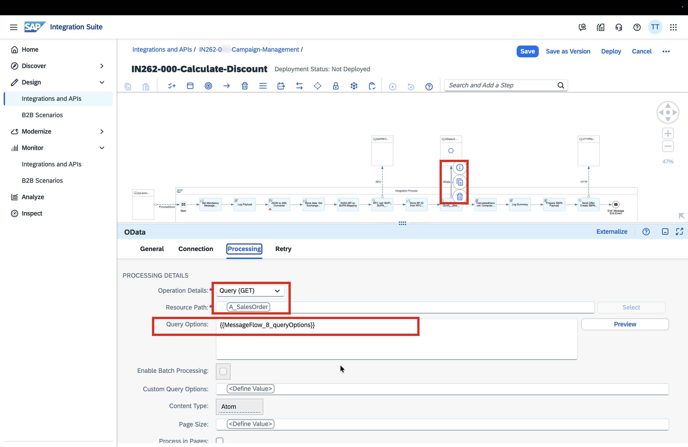
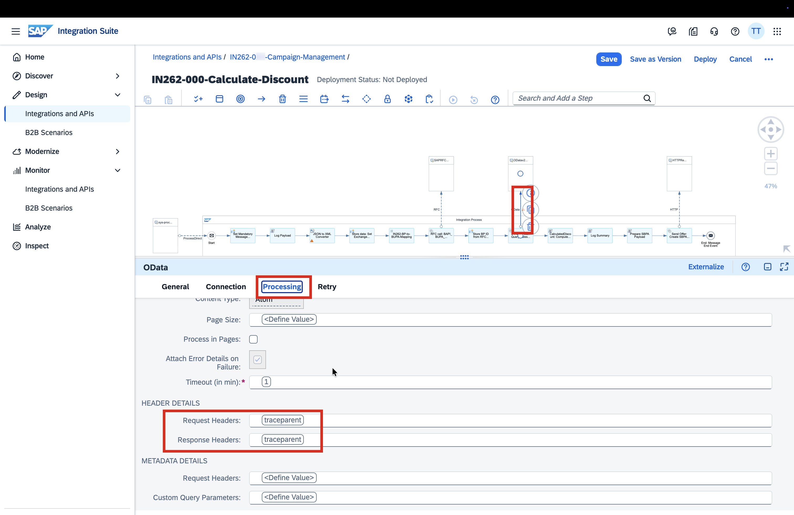
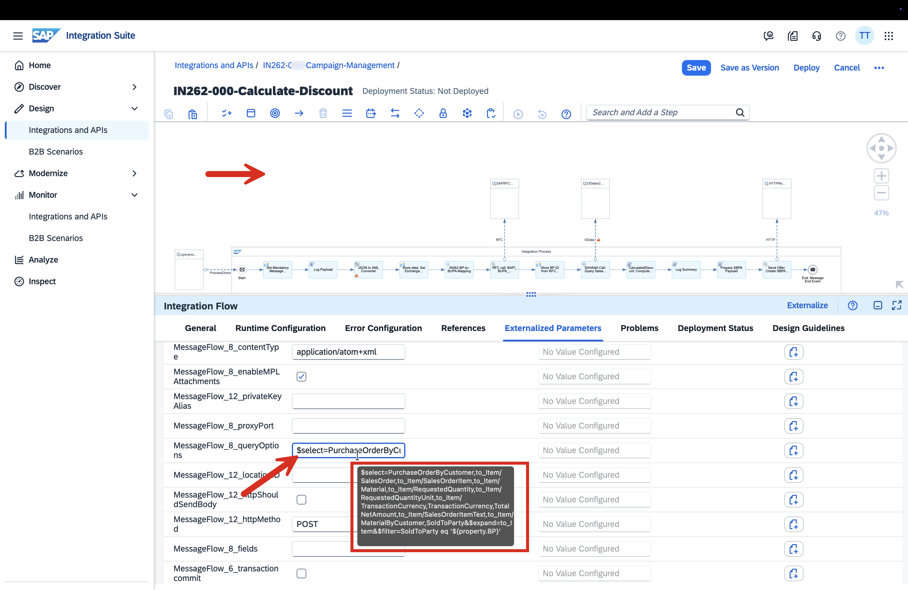
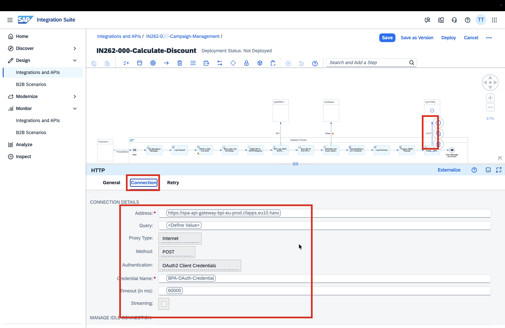

# Exercise 1: Generate an Integration Flow with AI and Optimise It

**AI Features:** iFlow Generation · Memory Profiling · Script Optimisation  
**Duration:** 25 minutes

---

## Business Context

You need to build an integration flow that receives a product launch event from S/4HANA, enriches it with customer and sales order data, calculates a personalised discount, and triggers a campaign workflow in SAP Build Process Automation. Instead of building this from scratch step by step, you describe the scenario in natural language and let AI generate the structure for you — then you wire it to the shared artefacts, profile its memory usage, and optimise it before deploying.

---

## What AI Does Here

| Capability | When it fires | What you see |
|---|---|---|
| **iFlow Generation** | You paste a prompt describing the scenario | AI generates the complete flow structure: steps, adapters, local processes, and a pre-filled name |
| **Memory Profiling** | You run the Simulator with Memory Profiling enabled | AI identifies which script step consumes the most memory and explains why |
| **Script Optimisation** | You click "Optimise with AI" on the flagged script | AI proposes targeted code fixes across memory, precision, and error handling |

---

## Prerequisites

- Access to the Integration Suite tenant:  
  `https://workshop02a.integrationsuite-cpi049.cfapps.eu10-003.hana.ondemand.com`
- The `IN262-Common-Artifacts` package is deployed in the tenant (contains the Script Collection and Message Mapping used in this exercise)
- Your participant number `[NNN]` — printed on your session card (001–040)

---

## Naming Convention

Replace `0XX` with your 3-digit participant number throughout this exercise.

| What | Format | Example for participant 050 |
|---|---|---|
| Package name | `IN262-0XX-Campaign-Management` | `IN262-050-Campaign-Management` |
| iFlow name | `IN262-0XX-Calculate-Discount` | `IN262-050-Calculate-Discount` |
| ProcessDirect address | `/IN262-0XX` | `/IN262-050` |

---

# Exercise 1.1 — Generate the iFlow with AI

---

## Step 1 — Create Your Integration Package

1. In the Integration Suite home, navigate to **Design → Integrations and APIs**

   

2. Click **Create** (top right)

3. Fill in the package header:

   | Field | Value |
   |---|---|
   | **Name** | `IN262-0XX-Campaign-Management` |
   | **Technical Name** | `IN2620XXCampaignManagement` *(auto-filled)* |
   | **Short Description** | `The package to trigger a campaign for a newly launched product automatically using AI features like generation of iFlows, profiling, script optimisation, error resolution, MCP servers etc.` |
   | **Version** | `1.0.0` |
   | **Vendor** | `SAP` |

   

4. Click **Save** — you will see the confirmation toast *"The package has been successfully created"*

   

---

## Step 2 — Add an Integration Flow Using AI Generation

1. Click the **Artifacts** tab
2. Click **Add → Integration Flow**

   

3. In the dialog, select **"Generate Integrations with assistance from AI"**

   

4. The **Generate Integration Flow** dialog opens with a prompt text area

   

---

## Step 3 — Paste the AI Prompt

Copy the full prompt below and paste it into the **"Describe your integration scenario"** field:

```
I need to build an integration flow called IN262-0XX-Calculate-Discount where 0XX is my participant ID (for example IN262-050-Calculate-Discount for participant 050). It should use a ProcessDirect sender adapter with address /IN262-0XX where 0XX is my participant ID.

The flow works like this: it receives a JSON payload, converts it to XML using a JSON to XML Converter with root element name "root" and no namespaces. Before that conversion, add a Groovy Script step called "Log Payload" that references script9 from the script collection "IN262-Script-Collection" in package "IN262-Common-Artifacts" which contains all commonly use artifacts across this exercise.

After the converter, add a Content Modifier called "Store data" that sets these exchange properties: defaultDiscount as constant value 5, ThresholdeValue as constant value 5000, discount as an empty constant, email as XPath //participantEmail with datatype java.lang.String, and ProductID as XPath //productId with datatype java.lang.String.

Next, add a Message Mapping step called "Mapping for RFC Call" that uses the mapping "IN262-BP-to-BUPA-Mapping" from the same Common Artifacts package.

Then add a Request Reply step called "RFC call" with an RFC receiver adapter using destination S4HANA_RFC, BAPI BAPI_BUPA_ADDRESS_GETDETAIL, and Synchronous RFC protocol.

After the RFC call, add a Content Modifier called "Store BP id" with one exchange property: BP using XPath //*[local-name()='PARTNER'][starts-with(text(), 'USCU-PT')] as java.lang.String.

Then add a Request Reply called "S4Hana Call" using an OData V2 receiver adapter with address http://s4hana-he4-teched:50080/sap/opu/odata/sap/API_SALES_ORDER_SRV, SAP Cloud Connector proxy with location ID IN262, Basic authentication with credential alias HE4, Query GET operation on resource A_SalesOrder, CSRF disabled, and query options: $select=PurchaseOrderByCustomer,to_Item/SalesOrder,to_Item/SalesOrderItem,to_Item/Material,to_Item/RequestedQuantity,to_Item/RequestedQuantityUnit,to_Item/TransactionCurrency,TransactionCurrency,TotalNetAmount,to_Item/SalesOrderItemText,to_Item/MaterialByCustomer,SoldToParty&$expand=to_Item&$filter=SoldToParty eq '${property.BP}'

After the OData call, invoke a local integration process called "Calculate discount and total price".

Then add a Groovy Script step called "Log Summary" referencing script10 from IN262-Script-Collection, followed by another Groovy Script called "Prepare SBPA Payload" referencing script11 from the same collection.

Finally, add a Request Reply step called "Send Offer" using an HTTP receiver adapter with POST method, URL https://spa-api-gateway-bpi-eu-prod.cfapps.eu10.hana.ondemand.com/workflow/rest/v1/workflow-instances, and OAuth2 Client Credentials authentication with credential name BPA-OAuth-Credential. End the flow with a Message End Event.

For the local integration process "Calculate discount and total price": start with a Groovy Script called "Calculate Total Price" referencing script4 from IN262-Script-Collection. Then add an Exclusive Gateway called "Check discount percentage". One route named "Net amount >= 5000" uses the Non-XML condition ${property.TotalPrice} >= ${property.ThresholdeValue} and leads to a Groovy Script called "Calculate discount price" referencing script5 from the same collection. The default route leads to another Groovy Script also called "Calculate discount price" but referencing script8. Both routes end at the same End Event.
```

> **Remember to replace `0XX` with your participant number before clicking Generate.**


---

## Step 4 — Review AI Analysis and Generate

1. The AI analyses your prompt and shows the identified systems and actions — review it

   

2. Verify the **Name** field at the bottom shows `IN262-0XX-Calculate-Discount` with your participant number

3. Click **Generate**

   

4. AI generates the iFlow — the dialog closes and the new artefact appears in the package

   

---

## Step 5 — Open the Generated iFlow

1. Click the iFlow name `IN262-0XX-Calculate-Discount` to open it
2. Click **Edit** (top right) to enter edit mode

   

> The AI has generated the flow structure. You will now see some steps with error indicators — these are local placeholder artefacts (scripts and a mapping) that were created inside this iFlow. In the next steps you will replace them with the shared artefacts from the Common Artifacts package.

---

## Step 6 — Remove Local Artefacts (Fix 1)

The AI generated local copies of the scripts and mapping. These must be deleted and replaced with the global shared versions.

1. In the bottom panel, click the **References** tab, then **Local (5)**

   

2. Delete **`IN262-BP-to-BUPA-Mapping`** (Message Mapping) — click the delete icon → confirm **Delete**

   

3. Delete **`CalculatedDiscount`** Groovy Script → confirm **Delete**

   

4. Delete **`Log Payload`** Groovy Script → confirm **Delete**

   

5. Delete **`Log Summary`** Groovy Script → confirm **Delete**

   

6. Delete **`SBPA_Payload`** Groovy Script → confirm **Delete**

   

> Local tab now shows **Local (0)**.

---

## Step 7 — Add Global Message Mapping Reference (Fix 2)

1. Click the **Global (0)** tab
2. Click **Add References → Message Mapping**

   

3. In the References dialog, click the Package dropdown — it defaults to your own package

   

4. Clear the current package and select **`IN262-Common-Artifacts`**

   

   

5. The artifact list shows **`IN262-BP-to-BUPA-Mapping`** — tick the checkbox

   

6. Click **OK** — the mapping appears under Global (1)

   

---

## Step 8 — Add Global Script Collection Reference (Fix 3)

1. Click **Add References → Script Collection**

   

2. In the References dialog, clear the package and select **`IN262-Common-Artifacts`**

   

   

3. The artifact list shows **`IN262-Script-Collection`** — tick the checkbox

   

4. Click **OK** — Global tab now shows **Global (2)**

   

5. Click **Save** — confirm the *"saved"* toast

   

   

---

## Step 9 — Wire Scripts to the Script Collection (Fix 4)

The script steps still point to the deleted local files. Wire each one to the correct script in the Script Collection.

> For each step below: click the step on the canvas → **Processing** tab → click **Select** → switch to **Global Resources** tab → select the script → click **OK** → **Save**.

### 9a — Log Payload

1. Click the **Log Payload** step on the canvas
2. Processing tab → click **Select**

   

3. Switch to **Global Resources** tab → select **`Log Payload`** from the list → click **OK**

   

4. Click **Save**

   

### 9b — Message Mapping step

1. Click the **IN262-BP-to-BUPA-Mapping** step on the canvas
2. Processing tab → click **Select**

   

3. Switch to **Global Resources** tab → select **`IN262262BPtoBUPAMapping`** → click **OK**

   

4. Click **Save**

   

### 9c — CalculatedDiscount

1. Click the **CalculatedDiscount: Compute…** step on the canvas
2. Processing tab → click **Select**

   

3. Global Resources → select **`CalculatedDiscount`** → click **OK**

   

4. Click **Save**

   

### 9d — Log Summary

1. Click the **Log Summary** step → Processing tab → **Select**

   

2. Global Resources → select **`Log Summary`** → click **OK**

   

3. Click **Save**

   

### 9e — Prepare SBPA Payload

1. Click the **Prepare SBPA Payload** step → Processing tab → **Select**

   

2. Global Resources → select **`SBPA_Payload`** → click **OK**

   

3. Click **Save**

   

---

## Step 10 — Verify the Full iFlow and Adapter Settings

1. Click the **Arrange Horizontally** button (bottom of canvas) to see the complete flow

   

   

2. Click the **ProcessDirect** sender step → **Connection** tab — confirm the address shows `/IN262-0XX` with your participant number

   

3. Click the **RFC call** step → **Connection** tab — confirm Destination = `S4HANA_RFC`

   

4. Click the **S4Hana Call** OData step → **Processing** tab — confirm Resource Path = `A_SalesOrder` and Query Options are populated

   

5. Scroll down in Processing — confirm Request/Response Headers = `traceparent`

   

6. Click **Externalized Parameters** tab — confirm the query options and OData body parameters are listed

   

7. Click the **Send Offer** HTTP step → **Connection** tab — confirm:
   - Address: `https://spa-api-gateway-bpi-eu-prod.cfapps.eu10.hana.ondemand.com/workflow/rest/v1/workflow-instances`
   - Method: `POST`
   - Authentication: `OAuth2 Client Credentials`
   - Credential Name: `BPA-OAuth-Credential`

   

---

## Step 11 — Save as Version and Deploy

1. Click **Save as Version**

   

2. In the Version Information dialog:
   - **Version:** `1.0.1`
   - **Comment:** `Adjusted the common artifacts`
   - Click **Save**

   

3. Toast confirms *"saved as version"* — click **Deploy**

   

4. In the Deploy dialog, confirm **Runtime Profile = Cloud Integration** → click **Deploy**

   

5. Confirm the deployment dialog → click **OK**

   

6. Toast confirms *"successfully deployed"*

   

7. Click **Deployment Status** tab — confirm Runtime Status = **Started**

   

---

## Exercise 1.1 Complete

Your iFlow is deployed and running. It was generated from a plain-language description, wired to shared artefacts, and is now live — without writing a single line of code or configuring adapters manually.

---

---

# Exercise 1.2 — Profile Memory and Optimise with AI

> **Note:** Screenshots for this section are pending capture. The steps below describe the confirmed exercise design. Follow the instructions as written — the UI matches what is described.

---

## Business Context

The iFlow you deployed contains a Groovy script (`CalculatedDiscount`) with several coding issues introduced deliberately. Before accepting it for production, you will use the Integration Suite **Simulator with AI Memory Profiling** to surface the bottleneck — and then let **AI Script Optimisation** fix it.

---

## What AI Does Here

| Capability | What happens |
|---|---|
| **Memory Profiling** | Runs the script steps inside the Simulator, measures per-step memory allocation, and flags the most memory-intensive step with AI-generated recommendations |
| **Script Optimisation** | Analyses the flagged Groovy script and proposes fixes across three categories: memory efficiency, numeric precision, and error observability |

---

## Step 1 — Open the iFlow in Edit Mode

1. Navigate to your iFlow `IN262-0XX-Calculate-Discount`
2. Click **Edit** to enter edit mode

---

## Step 2 — Open the Simulator

1. In the toolbar, click the **Simulate** icon (or select **Simulation** from the toolbar)
2. Set the simulation **start point** to the **CalculatedDiscount: Compute…** Groovy script step
3. Set the simulation **end point** to the **Message End Event**

> The simulator does not make external calls — it only instruments the steps within the boundary you define. The S/4HANA OData call, RFC call, and HTTP (BPA) call are outside this scope and will not be executed.

---

## Step 3 — Load Sample Input Payload

1. In the Simulator input area, paste the sample S/4HANA Sales Order XML provided by your instructor
2. This payload represents a realistic OData response from `API_SALES_ORDER_SRV` with several orders and line items

> The payload needs to be large enough that the memory difference between `getBody(String)` and `getBody(Reader)` is visible in the profiler output.

---

## Step 4 — Enable Memory Profiling and Run

1. Tick the **Memory Profiling** checkbox in the Simulator panel
2. Click **Run**
3. The simulation executes — results appear in the **Memory Profiling Insights** panel

---

## Step 5 — Review the Memory Profiling Results

The Memory Profiling Insights view shows per-step memory allocation. Identify:

- The **CalculatedDiscount** script is flagged as the top memory consumer
- The AI recommendation explains that `getBody(String)` loads the entire payload into heap memory

---

## Step 6 — Optimise the Script with AI

1. Click **"Optimise with AI"** on the `CalculatedDiscount` step in the profiling results
2. The AI Script Optimisation panel opens and analyses the script
3. Review the **three recommendations** AI surfaces:

   | # | Issue found | Category | AI-proposed fix |
   |---|---|---|---|
   | 1 | `message.getBody(String)` | **Memory** | Replace with `message.getBody(java.io.Reader)` — streams the payload instead of loading it fully into heap |
   | 2 | `double` / `Double.parseDouble()` for price calculation | **Precision** | Replace with `BigDecimal` — avoids floating-point rounding errors on financial amounts |
   | 3 | Empty `catch` block swallowing exceptions silently | **Observability** | Add MPL logging via `messageLogFactory` — failures become visible in Message Monitor |

4. Review each recommendation and click **Accept** to apply all three fixes

---

## Step 7 — Save and Deploy (Final)

1. Click **Save**
2. Click **Deploy** — this is the final deployment; the iFlow now runs with the AI-optimised script

---

## Exercise 1.2 Complete

You used AI to profile memory usage before going live, identified a real coding issue in the script, and applied AI-generated fixes across three categories — all without leaving the Integration Suite designer.

---

## Key Takeaway

AI assisted at every stage of this exercise:
- **Generated** the integration structure from a plain-language description
- **Profiled** memory usage in simulation — no deployment needed to find the bottleneck
- **Optimised** the script with targeted fixes for memory, precision, and observability

---

*Next: [Exercise 2 — AI Error Resolution](../ex2/README.md)*
