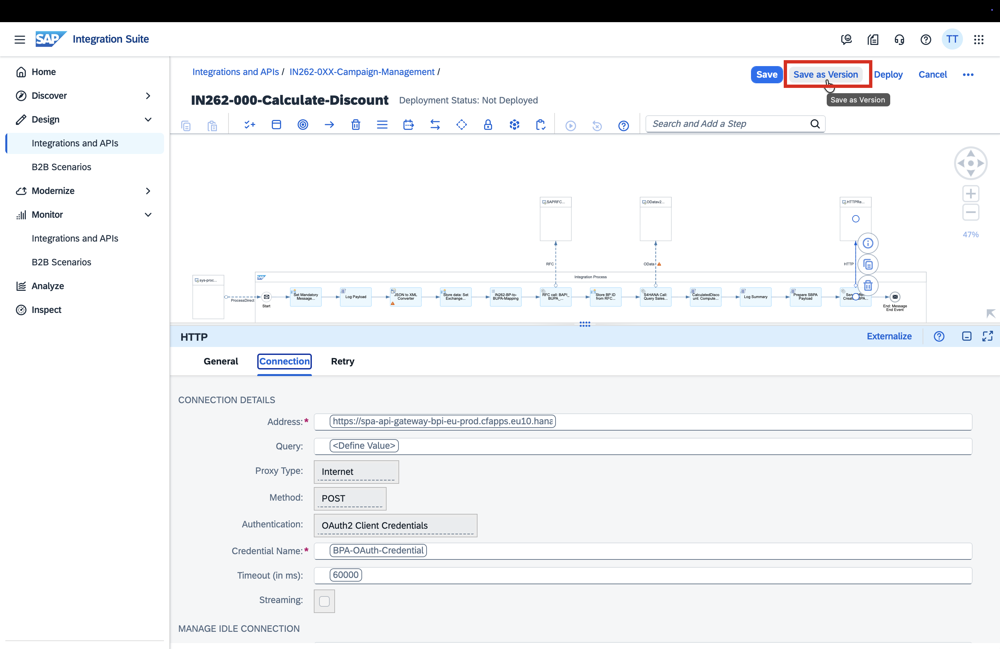
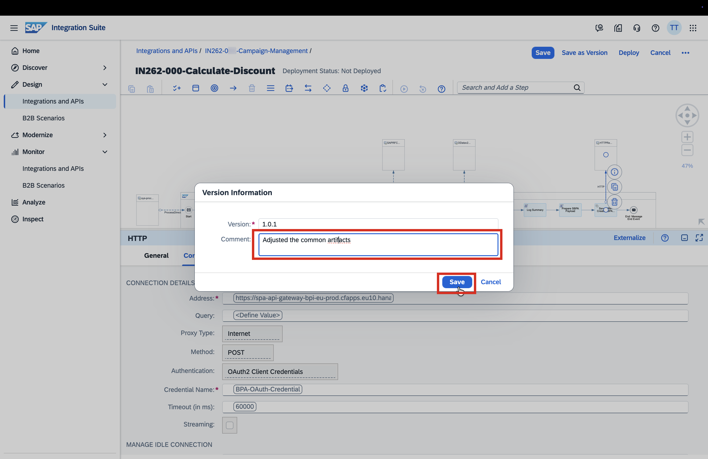
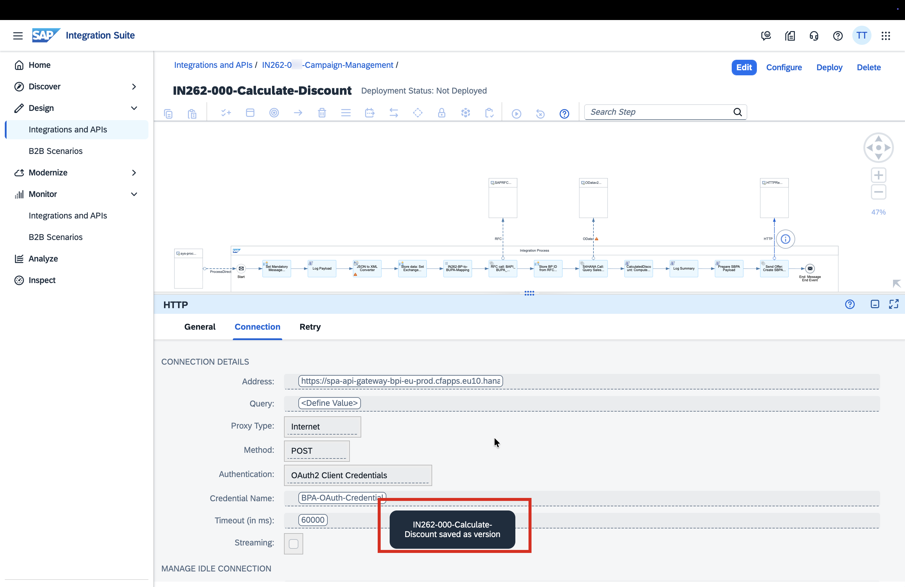
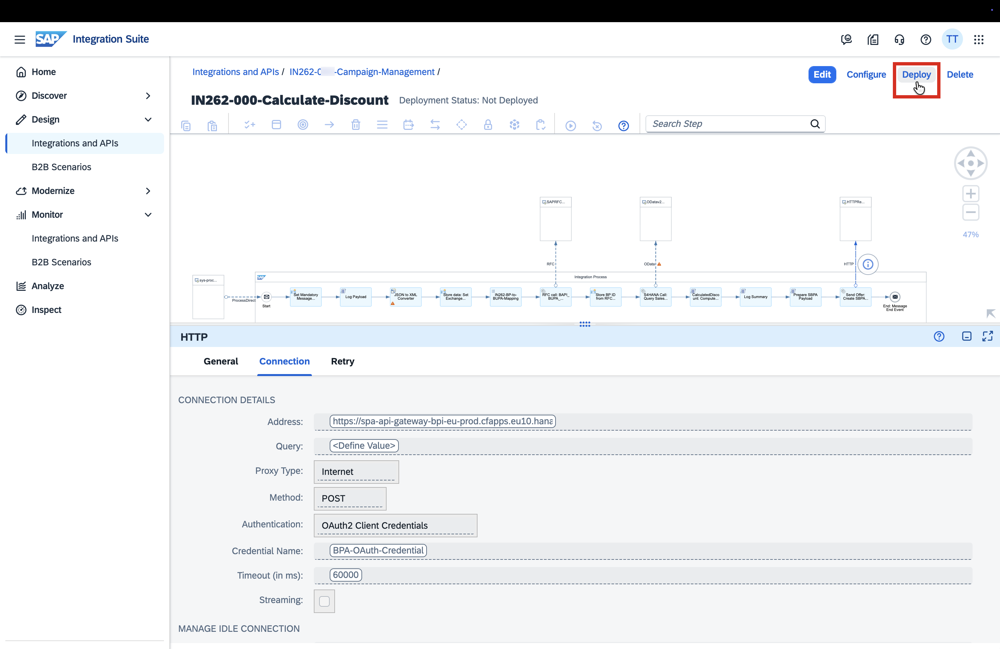
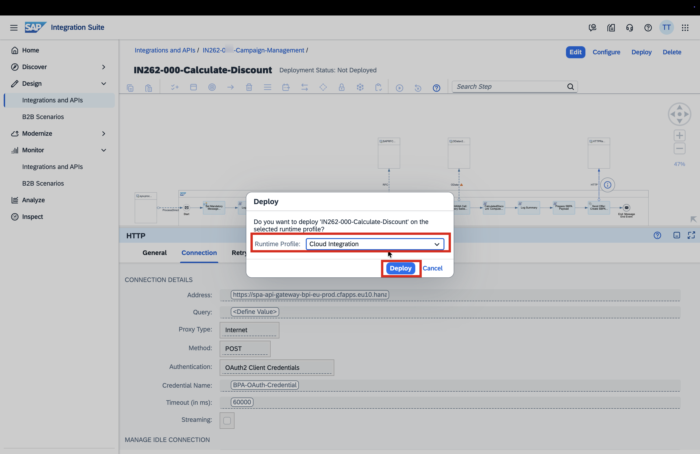
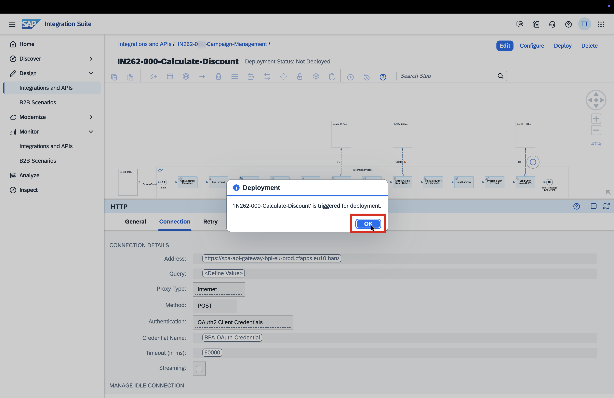
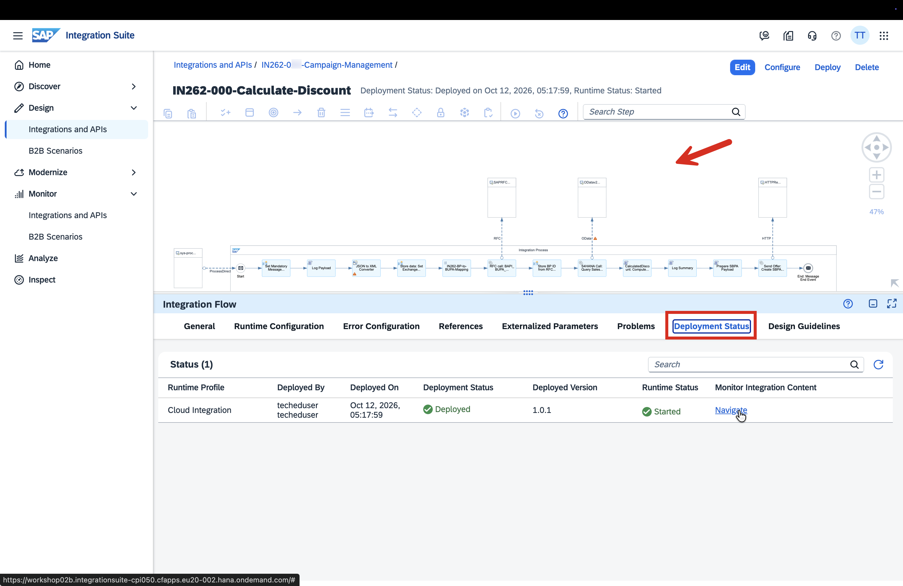

# Exercise 1.2 — Memory Profiling and Script Optimisation

**AI Features:** Memory Profiling · Script Optimisation  
**Duration:** 10 minutes

---

## Business Context

The iFlow you saved in Exercise 1.1 contains a Groovy script (`CalculatedDiscount`) with several coding issues introduced deliberately. Before deploying it to production, you will use the Integration Suite **Simulator with AI Memory Profiling** to surface the bottleneck — and then let **AI Script Optimisation** fix it.

---

## What AI Does Here

| Capability | What happens |
|---|---|
| **Memory Profiling** | Runs the script steps inside the Simulator, measures per-step memory allocation, and flags the most memory-intensive step with AI-generated recommendations |
| **Script Optimisation** | Analyses the flagged Groovy script and proposes fixes across three categories: memory efficiency, numeric precision, and error observability |

---

## Step 1 — Open the iFlow in Edit Mode

1. Navigate to your iFlow `IN262-0XX-Calculate-Discount`
2. Click **Edit** to enter edit mode

---

## Step 2 — Open the Simulator

1. In the toolbar, click the **Simulate** icon (or select **Simulation** from the toolbar)
2. Set the simulation **start point** to the **CalculatedDiscount: Compute…** Groovy script step
3. Set the simulation **end point** to the **Message End Event**

> The simulator does not make external calls — it only instruments the steps within the boundary you define. The S/4HANA OData call, RFC call, and HTTP (BPA) call are outside this scope and will not be executed.

---

## Step 3 — Load Sample Input Payload

1. In the Simulator input area, paste the sample S/4HANA Sales Order XML provided by your instructor
2. This payload represents a realistic OData response from `API_SALES_ORDER_SRV` with several orders and line items

> The payload needs to be large enough that the memory difference between `getBody(String)` and `getBody(Reader)` is visible in the profiler output.

---

## Step 4 — Enable Memory Profiling and Run

1. Tick the **Memory Profiling** checkbox in the Simulator panel
2. Click **Run**
3. The simulation executes — results appear in the **Memory Profiling Insights** panel

---

## Step 5 — Review the Memory Profiling Results

The Memory Profiling Insights view shows per-step memory allocation. Identify:

- The **CalculatedDiscount** script is flagged as the top memory consumer
- The AI recommendation explains that `getBody(String)` loads the entire payload into heap memory

---

## Step 6 — Optimise the Script with AI

1. Click **"Optimise with AI"** on the `CalculatedDiscount` step in the profiling results
2. The AI Script Optimisation panel opens and analyses the script
3. Review the **three recommendations** AI surfaces:

   | # | Issue found | Category | AI-proposed fix |
   |---|---|---|---|
   | 1 | `message.getBody(String)` | **Memory** | Replace with `message.getBody(java.io.Reader)` — streams the payload instead of loading it fully into heap |
   | 2 | `double` / `Double.parseDouble()` for price calculation | **Precision** | Replace with `BigDecimal` — avoids floating-point rounding errors on financial amounts |
   | 3 | Empty `catch` block swallowing exceptions silently | **Observability** | Add MPL logging via `messageLogFactory` — failures become visible in Message Monitor |

4. Review each recommendation and click **Accept** to apply all three fixes

---

## Step 7 — Save and Deploy (Final)

1. Click **Save**

   

2. In the Version Information dialog:
   - **Version:** `1.0.2`
   - **Comment:** `AI-optimised CalculatedDiscount script`
   - Click **Save**

   

3. Toast confirms *"saved as version"* — click **Deploy**

   

4. In the Deploy dialog, confirm **Runtime Profile = Cloud Integration** → click **Deploy**

   

5. Confirm the deployment dialog → click **OK**

   

6. Toast confirms *"successfully deployed"*

   

7. Click **Deployment Status** tab — confirm Runtime Status = **Started**

   

---

## Exercise 1.2 Complete

You used AI to profile memory usage before going live, identified a real coding issue in the script, and applied AI-generated fixes across three categories — all without leaving the Integration Suite designer.

---

## Key Takeaway

AI assisted at every stage of Exercise 1:
- **Generated** the integration structure from a plain-language description
- **Profiled** memory usage in simulation — no deployment needed to find the bottleneck
- **Optimised** the script with targeted fixes for memory, precision, and observability

---

*Next: [Exercise 2 — AI Error Resolution](../../ex2/README.md)*
