# Exercise 4 — End-to-End: Create a Product and Trigger the Campaign

**Feature:** Run end to end scenario

**Duration:** 15 minutes

---

## Business Context

You have built and deployed the integration flows in Exercises 1–3. In this exercise you will experience the full end-to-end business scenario as two roles:

1. **Data Steward** — use an AI agent (Claude Code CLI with your MCP server) to create a new product in S/4HANA. The agent handles the API call; you describe the product in plain language.
2. **End User / Customer** — receive the personalised campaign offer triggered by the product creation, approve it, and place the order.

---

## What AI Does Here

| Capability | What happens |
|---|---|
| **MCP Server** | Claude Code discovers your deployed MCP server as a tool and calls the S/4HANA product creation API on your behalf — no API client or manual payload construction required |
| **Natural language used to call APIs** | You describe the product in plain language; the agent maps it to the correct OData fields and handles authentication |

---

## Prerequisites

The following items are **pre-installed on your workstations** by the IT team:

- **Claude Code CLI** — installed and available via `claude` in the terminal
- **Bruno** — REST client installed
- **Visual Studio Code** — installed

- Your **participant number** (printed on your session card) — `001` through `040`

---

## Step 1 — Setup: Import Bruno Collection and Open .mcp.json

### Part A — Import Bruno Collection into Bruno

1. Right click open the file in new tab or window [Bruno Collection download link](downloads/IN262-Bruno-Collection.zip) 
   - click **Download raw file** to save the ZIP

   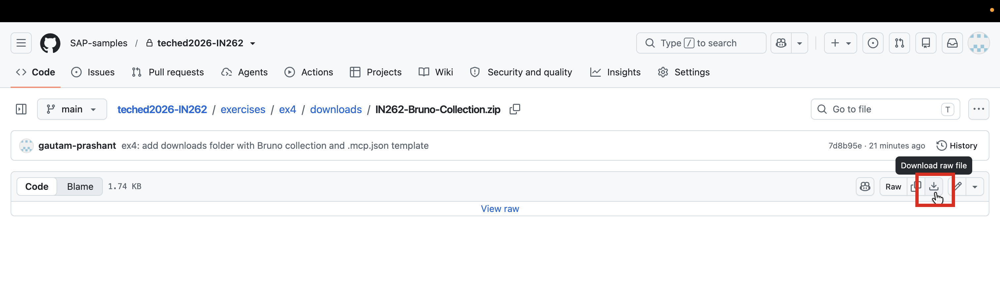

2. Open **Bruno** → click the `+` icon next to **Collections** in the left panel → select **Import collection**

   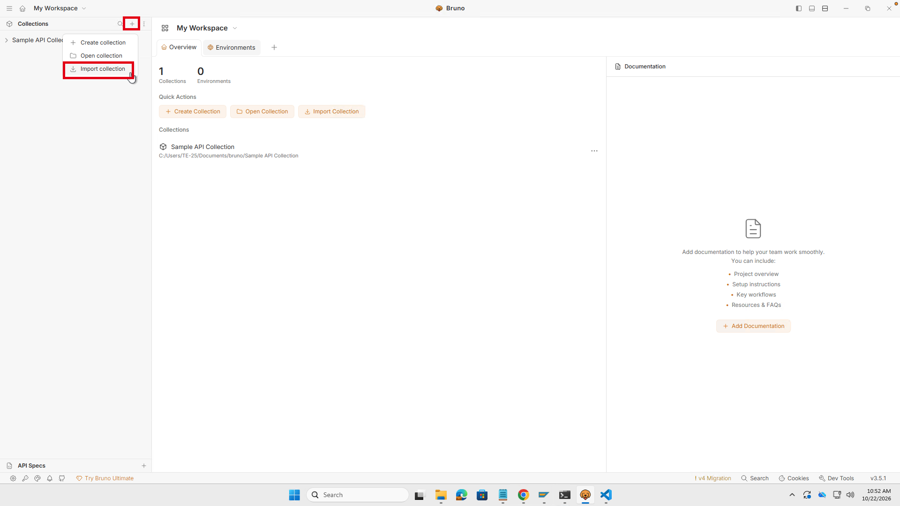

3. The Import Collection dialog opens — click **choose file(s)**

   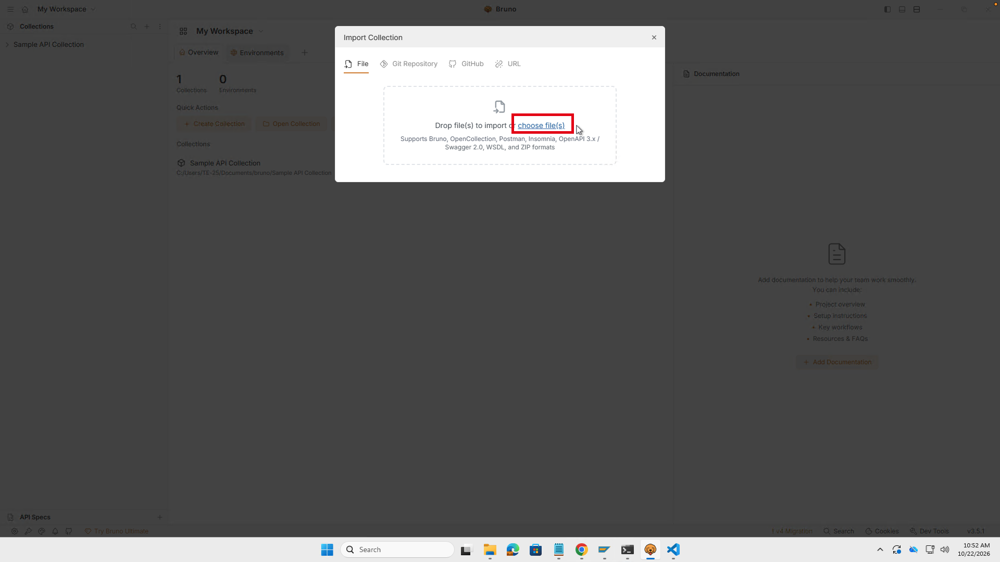

4. Navigate to your **Downloads** folder → select **IN262-Bruno-Collection.zip** → click **Open**

   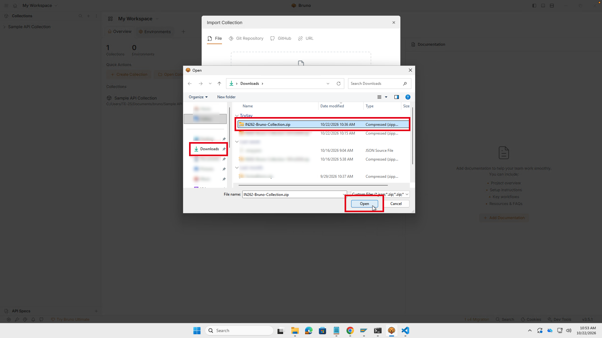

5. Confirm the collection name `IN262-Bruno-Collection` → click **Import**

   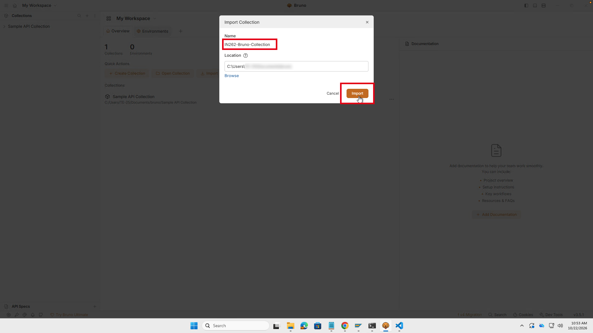

6. The collection **IN262-Bruno-Collection** now appears in Bruno — it is ready for use in Step 2
   - Expand and verify the POST request call entry is available

   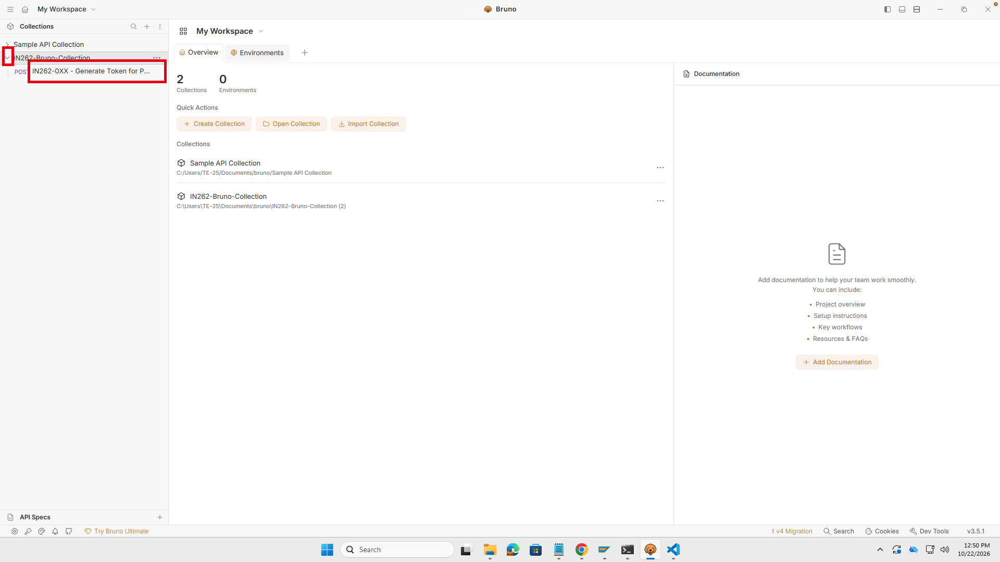

### Part B — Open .mcp.json in VS Code

7. Right click and Open the [.mcp.json download link](downloads/.mcp.json) 
   - on the GitHub page click **Download raw file** to save the file to your **Downloads** folder
   - <mark> verify file name is `.mcp.json` **(file name with leading dot)** </mark>
      - if required rename the file to `.mcp.json` with leading dot

> [!CAUTION]
> If browser save the file as **`mcp.json`** **(without the leading dot)**. 
> 
> You must rename it to **`.mcp.json`** after downloading:
> - Open your **Downloads** folder → right-click `mcp.json` → **Rename** → change to `.mcp.json` → press **Enter**
> - System may warn that changing the extension could make the file unusable — click **Yes**

   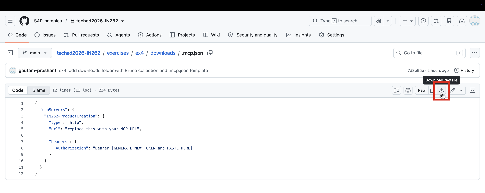


8. Open **Windows Explorer** 
   - Navigate to your download directory 
   - Copy the renamed file from your download folder to <mark>**`C:\Users\<windows-user>`**.</mark>

> [!TIP]
> 1. Windows user will be different from your participant number
> 
> 2. If the file already exists you can overwrite it.

   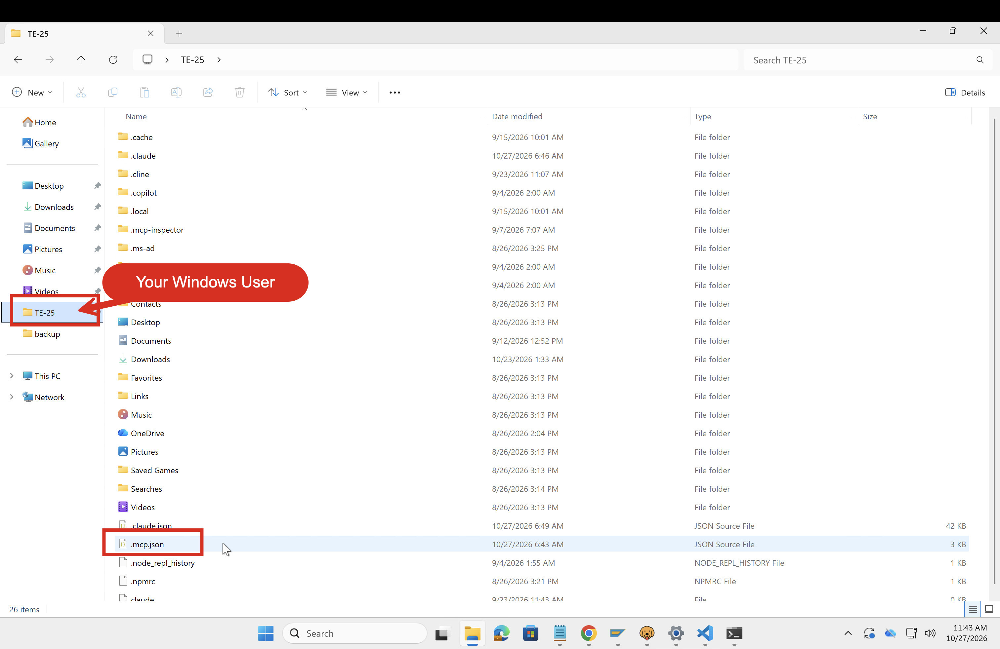


9. Right-click **.mcp.json** 
   - select **Open with → Visual Studio Code**
   
   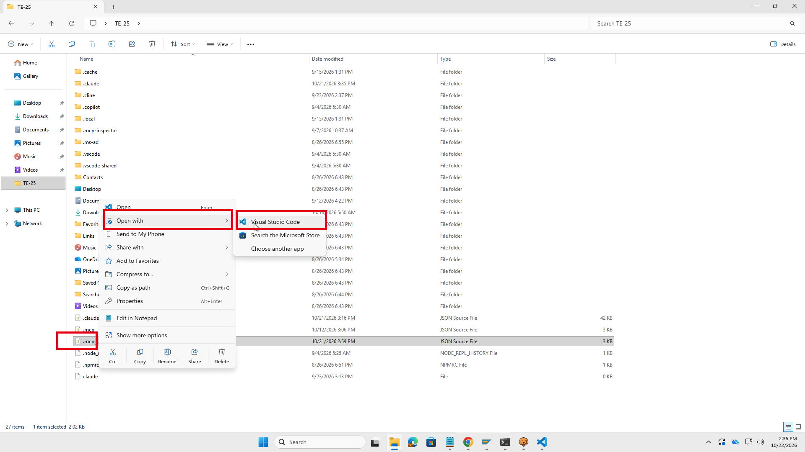
   
10. Keep VS Code open, we will fill the values in Step 4
   
   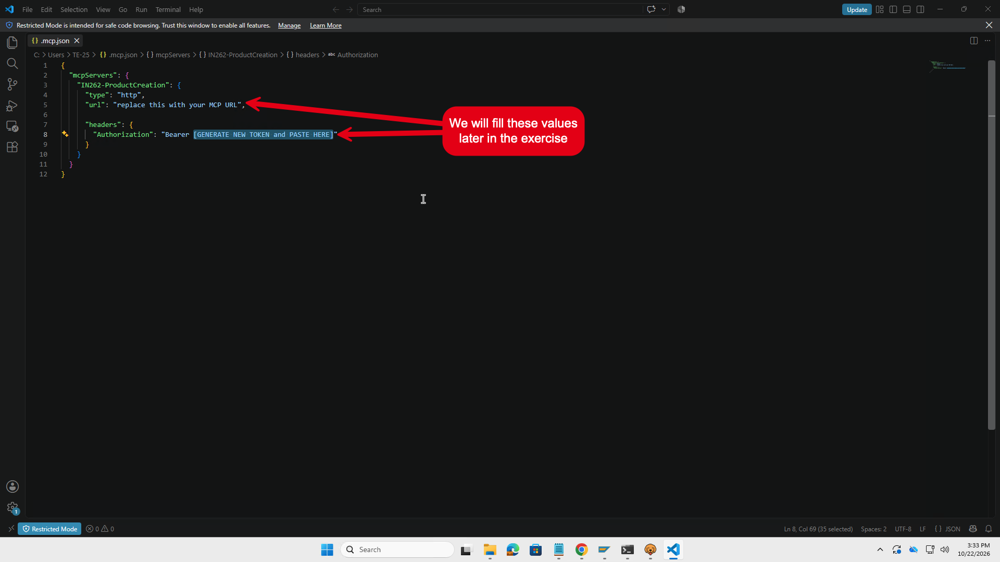


---

## Step 2 — Copy Your MCP Server Credentials from Developer Hub

Your MCP server credentials were created in Exercise 3. You will now retrieve them.

1. Navigate to **Developer Hub → My Workspace → Agents** tab and open your agent subscription **IN262-0XX-Agent-Subscription**
   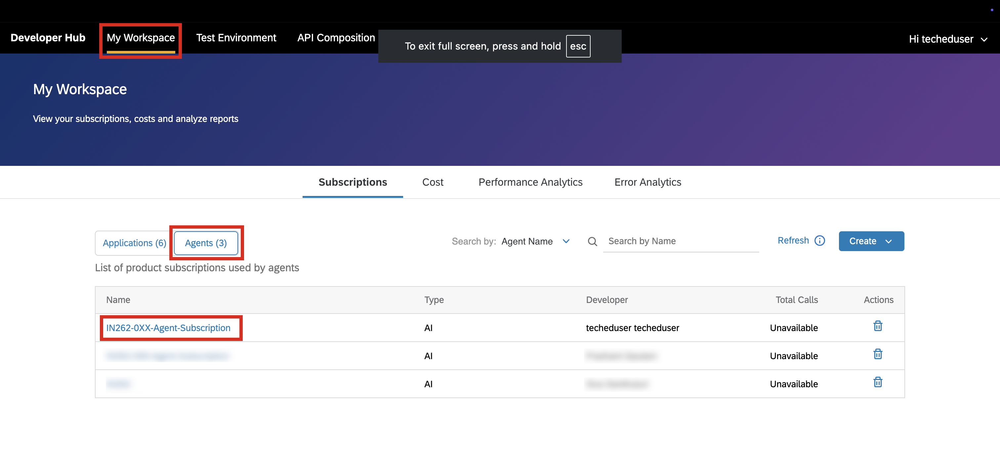
  

2. Click the **eye icon** next to the credentials to reveal the **Token URL**, **Key**, and **Secret**

   

> [!IMPORTANT]
> **Keep this browser tab open** — you will copy the Token URL, Key, and Secret directly from here into Bruno in the next step. Do not close or navigate away.

   

---

## Step 3 — Get Your MCP Access Token via Bruno

1. Open **Bruno** → expand **IN262-Bruno-Collection** in the left panel

   

2. Click **IN262-0XX - Generate Token for Product Creation MCP Server** — the POST request opens

   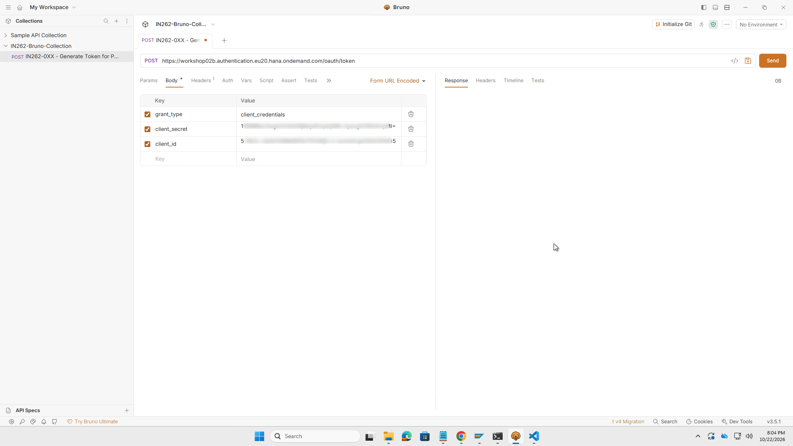


3. Switch to the **Developer Hub browser tab** and copy each value directly into Bruno:
   - **Token URL** → paste into the POST URL field at the top
   - **Key** → paste into the `client_id` value field
   - **Secret** → paste into the `client_secret` value field

   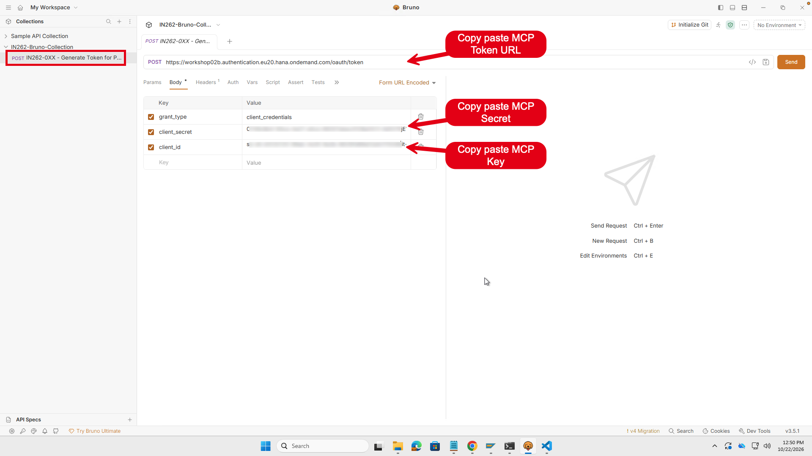

4. Click **Send** — the response returns a JSON body. Copy the `access_token` value **between the quotes**

   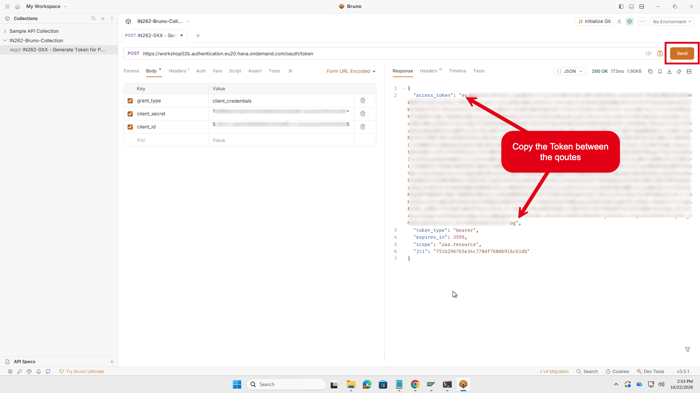

---

## Step 4 — Configure the MCP Server in .mcp.json

1. Switch to **VS Code** — the `.mcp.json` file is already open from Step 1. 

Update the following:   
   
   - Replace `[GENERATE NEW TOKEN and PASTE HERE]` with the `access_token` 
      - you copied in Step 3 or copy it from bruno
   - Replace `replace this with your MCP URL` 
      - with your MCP server URL (copied in Notepad in [Exercise 3.2 Step12](https://github.com/SAP-samples/teched2026-IN262/tree/main/exercises/ex3#exercise-32-create-and-configure-mcp-server))
      - you can also navigate to MCP server in developer hub to get MCP URL
   - Save the file (`Ctrl+S`)

> [!TIP]
> - Do not change the json file format
> 
> - There is a space between `Bearer` and new copied token from Bruno

   

---

## Step 5 — Start Claude Code CLI

1. Press the **Windows key**, type `command`, and click **Command Prompt**

>[!IMPORTANT]
> You should open Claude in the **same folder** where you saved **.mcp.json file**

   

2. In Command Prompt, type `claude` and press **Enter**

   

3. Claude Code prompts: **"Do you trust the files in this folder?"** — click **Yes, I trust this folder**

   

---

## Step 6 — Verify Your MCP Server is Connected

1. Type `/mcp` and press **Enter** — Claude Code lists all connected MCP servers

   

2. Confirm **IN262-ProductCreation** shows status **connected** and lists **12 tools**

> [!NOTE]
> If the server shows **disconnected** 
> - verify your `.mcp.json` has the correct URL
> - regenerate a valid token, paste it in `.mcp.json` again
> - restart Claude Code, type exit -> press eneter
>     - now you can again type claude to start new session

> [!TIP]
> Press Escape key to go back to prompt in Claude

---

## Step 7 — Create a Product via the AI Agent

You will now act as the **Data Steward** — using natural language to instruct the AI agent to create a product in S/4HANA.

1. Prepare the prompt by <mark>**adjusting it as given below (see example)**</mark>
   - copy and paste this prompt in notepad / text editor 
   - replace `0XX` with your 3-digit participant number
   - `NN` with `01` for your first product, `02` for your second attempt, and so on

> [!NOTE]
> **Example for participant 007, first attempt:**
> Product ID: `MZ-TG-ZAD01-IN262-00701` — Description: `Office Laptop IN262-00701`

```
Create a new product in S/4HANA with the following details:
- Product ID: MZ-TG-ZAD01-IN262-0XXNN
- Description: Office Laptop IN262-0XXNN
- Product Type: HAWA
- Industry Sector: M
- Base Unit: EA
- Language: EN
- Valuation Area (Plant): 1710
- Moving Average Price: 1000
- Currency: USD
- InventoryValuationProcedure: V
- ValuationClass: 3100
- PriceDeterminationControl: 2
- ProductSalesOrg: 1710
- ProductDistributionChnl: 10
- Item Category Group (MTPOS): NORM
```

   

2. Claude Code processes the request

   

3. Claude Code asks for confirmation to call the MCP tool — click **Yes** (or **Yes, and don't ask again for this server**)

   

4. Claude Code calls the **IN262-ProductCreation** tool on your MCP server

   

5. Claude Code confirms the product was created successfully — a summary table with all product fields is shown

> [!NOTE]
> The product creation triggers an AEM event in the background. The integration flow picks this up, calculates your personalised discount, and creates a campaign task in SAP Build Process Automation. This may take some seconds.

   

6. **[Monitor]** Go back to Integration Suite system to monitor integration flows</mark>

   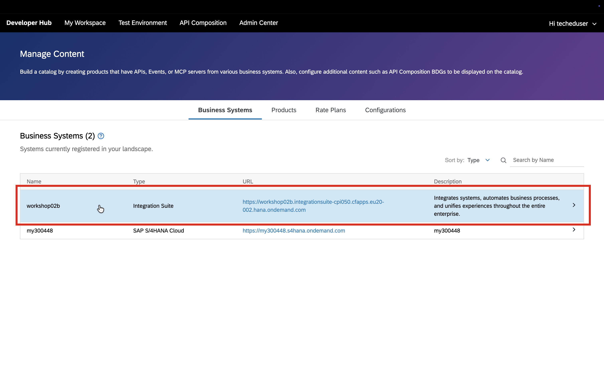

---

## Step 8 — Approve the Campaign Offer in My Inbox

You now switch roles — acting as the **End User / Customer** who receives the campaign offer.

1. Open your browser and navigate to the SBPA MyInbox:
   - Click on this link to open [My Inbox](https://url.sap/lf45f4)

>[!TIP]
> Sign in with **teched identity provider** or ask the instructor

   
2. Log in with your participant credentials (`in262-0XX@education.cloud.sap`)
   - Instructors will provide you the credentials

3. Refresh the task list using refresh button
   - Locate the task **Place Order - Product Offer** for your product
   - Review the offer details, confirm the quantity, and click **Place Order**

   

4. A **"Task processed successfully"** toast confirms the order was submitted

   

5. **[Monitor]** Go back to Integration Suite system to monitor integration flows</mark>

   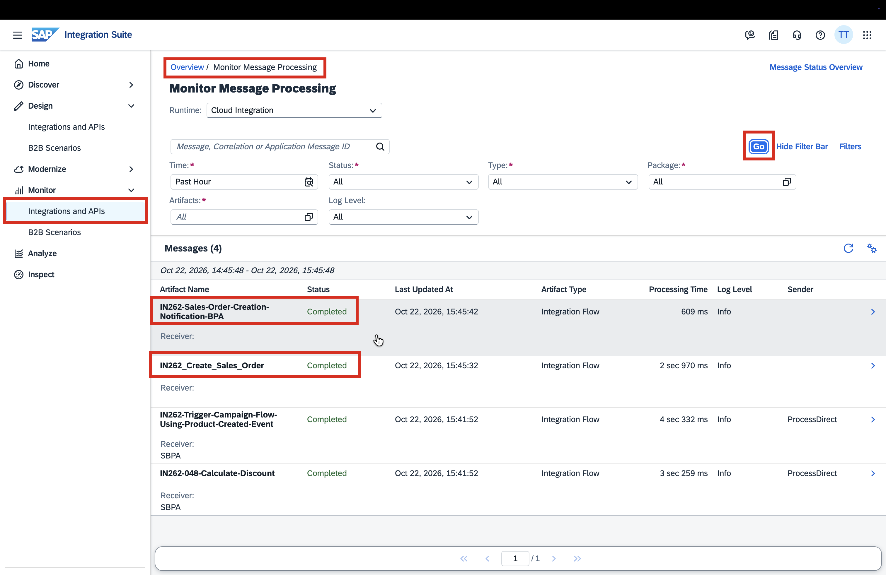

---

## Step 9 — Confirm the Sales Order

Once the order is created in the backend a notification will be sent back to you for order confirmation.

1. Click the **inbox icon** again — you should now see a **"A Sales Order Created"** notification

   

2. Note the **Sales Order number** assigned by S/4HANA — click **Acknowledge** to complete the flow

---

## Exercise 4 Complete

You have completed the full end-to-end journey:

1. Imported the Bruno collection and opened the `.mcp.json` template in VS Code
2. Retrieved MCP server credentials from Developer Hub
3. Used Bruno to exchange credentials for an OAuth access token
4. Configured `.mcp.json` with your MCP server URL and access token
5. Started Claude Code CLI and verified the MCP server is connected
6. Used an AI agent to create a product in S/4HANA — no API client, no manual payload
7. The integration platform picked up the event, calculated a personalised discount, and raised a campaign task
8. You placed the order and received the Sales Order confirmation

---

## Key Takeaway

This is AI-assisted integration in action: an AI agent bridged natural language to a governed enterprise API via MCP, while the integration platform handled the orchestration, enrichment, and business process automation in the background — without any manual intervention.

---

*[Back to overview](../../README.md)*
