# Exercise 4 — End-to-End: Create a Product and Trigger the Campaign

**Feature:** Run end to end scenario

**Duration:** 15 minutes

---

## Business Context

You have built and deployed the integration flows in Exercises 1–3. In this exercise you will experience the full end-to-end business scenario as two roles:

1. **Data Steward** — use an AI agent (Claude Code CLI with your MCP server) to create a new product in S/4HANA. The agent handles the API call; you describe the product in plain language.
2. **End User / Customer** — receive the personalised campaign offer triggered by the product creation, approve it, and place the order.

---

## What AI Does Here

| Capability | What happens |
|---|---|
| **MCP Server** | Claude Code discovers your deployed MCP server as a tool and calls the S/4HANA product creation API on your behalf — no API client or manual payload construction required |
| **Natural language → API call** | You describe the product in plain language; the agent maps it to the correct OData fields and handles authentication |

---

## Prerequisites

The following items are **pre-installed on your laptop** by the session IT team:

- **Claude Code CLI** — installed and available via `claude` in the terminal
- **Bruno** — REST client installed
- **Visual Studio Code** — installed

The following items are **provided by the session instructor** at the start:

- Bruno collection: `TechEd26-IN262` (imported into Bruno) — [Download Bruno Collection](downloads/IN262-Bruno-Collection.zip)
- MCP Server config template — [Download .mcp.json](downloads/.mcp.json)
- Your **participant number** (printed on your session card) — `001` through `040`

---

## Step 1 — Copy Your MCP Server Credentials from Developer Hub

Your MCP server credentials were created in Exercise 3. You will now retrieve them.

1. Navigate to **Developer Hub → My Workspace → Agents** tab and open your agent subscription **IN262-0XX-Agent-Subscription**

   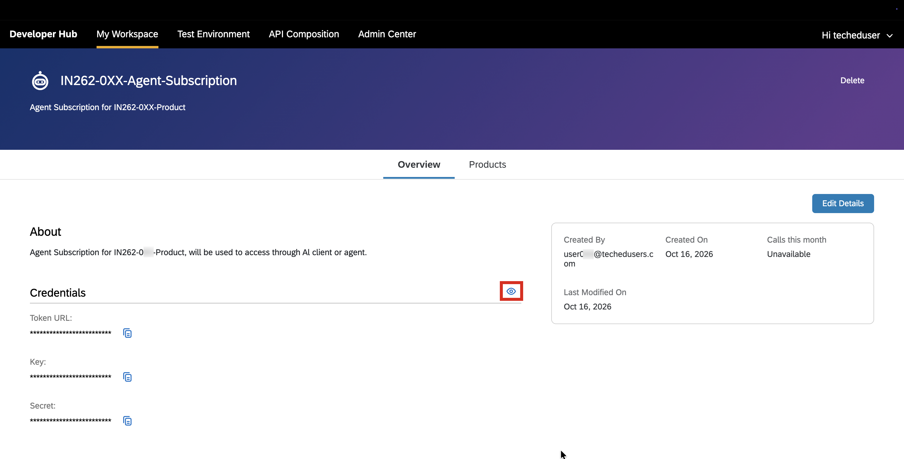

2. Click the **eye icon** next to the credentials to reveal the **Token URL**, **Key**, and **Secret**

   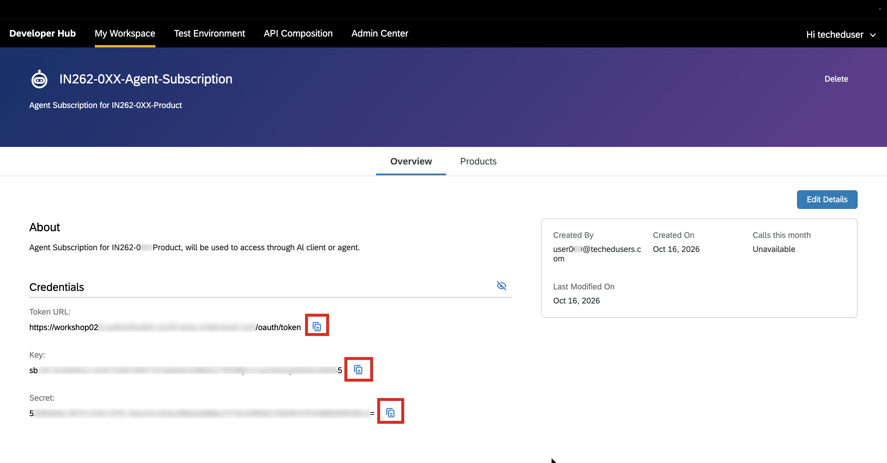

> [!NOTE]
> Copy the **Token URL**, **Key**, and **Secret** — you will need them in the next step to obtain an access token.

---

## Step 2 — Get Your MCP Access Token via Bruno

You will use the Bruno collection to exchange your credentials for a short-lived access token.

1. Open **Bruno** and select the **TechEd26-IN262** collection — open the **Get MCP Token** request

   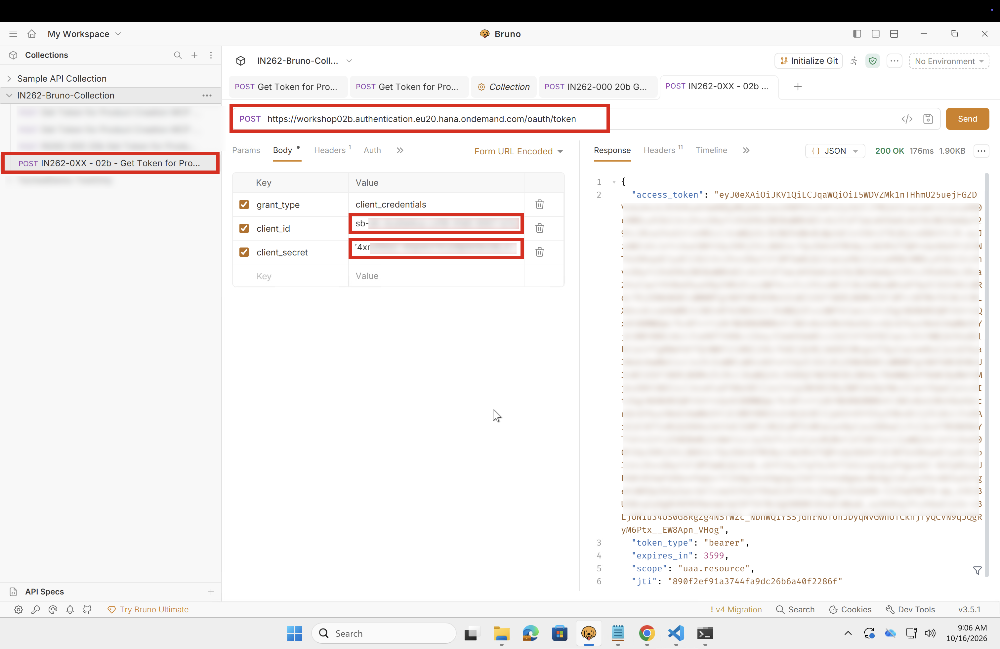

2. Confirm your credentials are set
   - Click **Send**
   - Copy the `access_token` value from the response — you will paste it into `.mcp.json` in the next step

   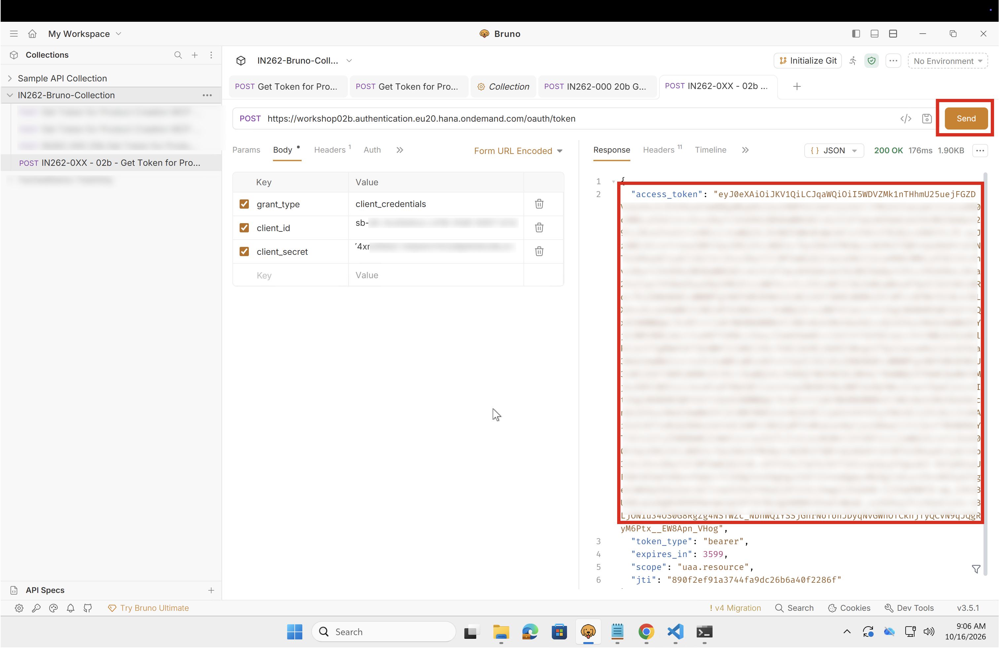

---

## Step 3 — Configure the MCP Server in Claude Code

1. Open **Windows Explorer**, navigate to your home directory (`C:\Users\TE-25`), and locate the `.mcp.json` file

   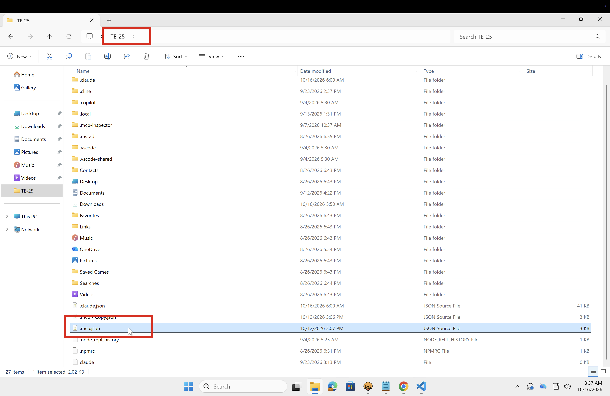

2. Right-click `.mcp.json` and select **Open with → Visual Studio Code**

   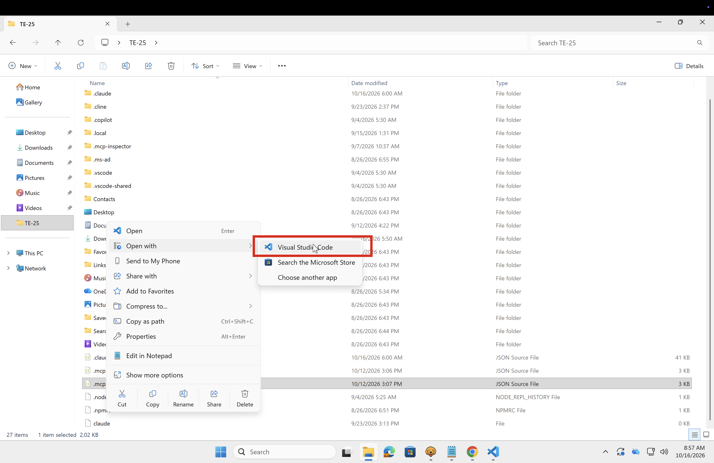

3. The file opens in VS Code. 
   - Paste entire JSON after changes or change the specific parts
      - Replace `XX` at the end of URL with your parcipant number 
      - Replace `[YOUR_TOKEN]` with the access token you copied
   - Save the file (`Ctrl+S`)

> [!NOTE]
> The URL above is for the **dry run (workshop02b)**. Replace `XX` with your participant number.
```json
{
  "mcpServers": {
    "IN262-ProductCreation": {
      "type": "http",
      "url": "https://workshop02b-1727b6a7b06944a096591f5568a14821.a.integration.cloud.sap/mcp_in262-0XX",
     
      "headers": {
        "Authorization": "Bearer [YOUR_TOKEN]"
      }
    }
  }
}
```

   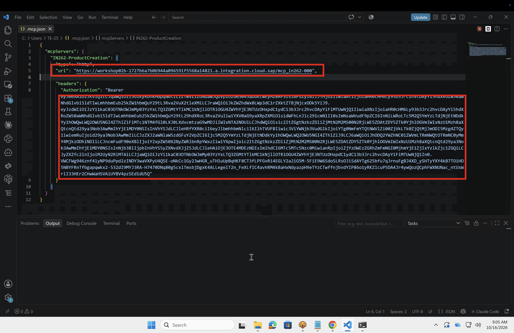


---

## Step 4 — Start Claude Code CLI

1. Press the **Windows key**, type `command`, and click **Command Prompt**

   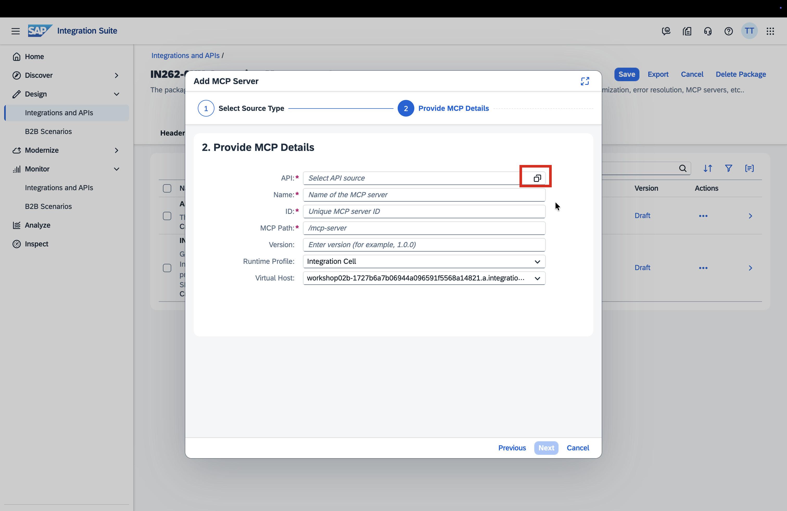

2. In Command Prompt, type `claude` and press **Enter**

   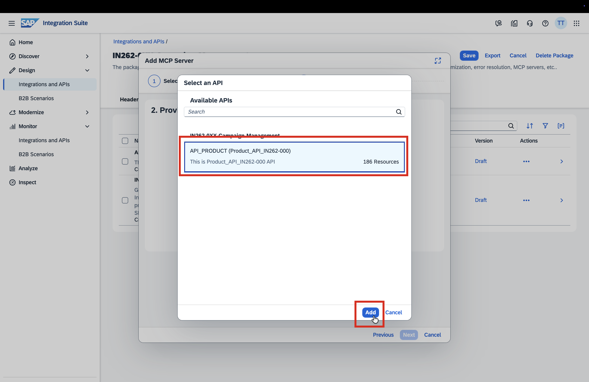

3. Claude Code prompts: **"Do you trust the files in this folder?"** — click **Yes, I trust this folder**

   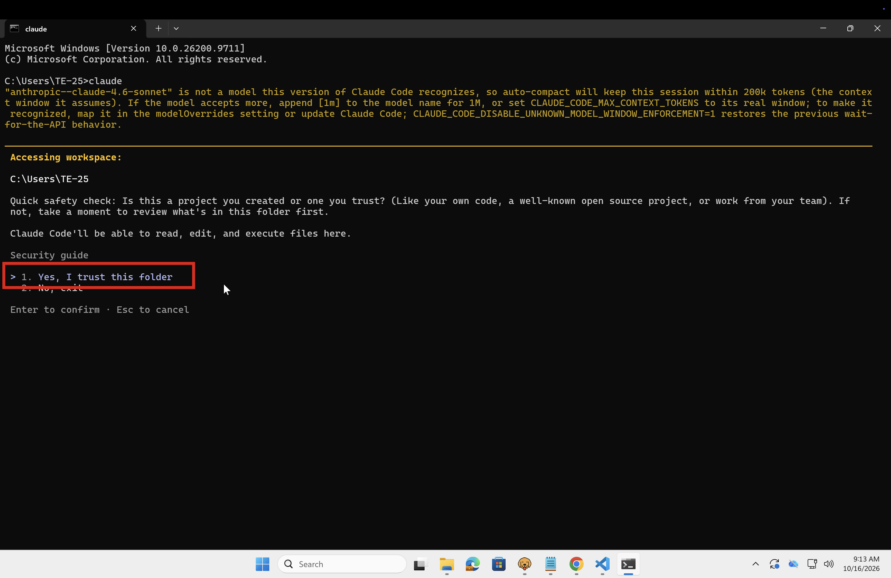

---

## Step 5 — Verify Your MCP Server is Connected

1. Type `/mcp` and press **Enter** — Claude Code lists all connected MCP servers

   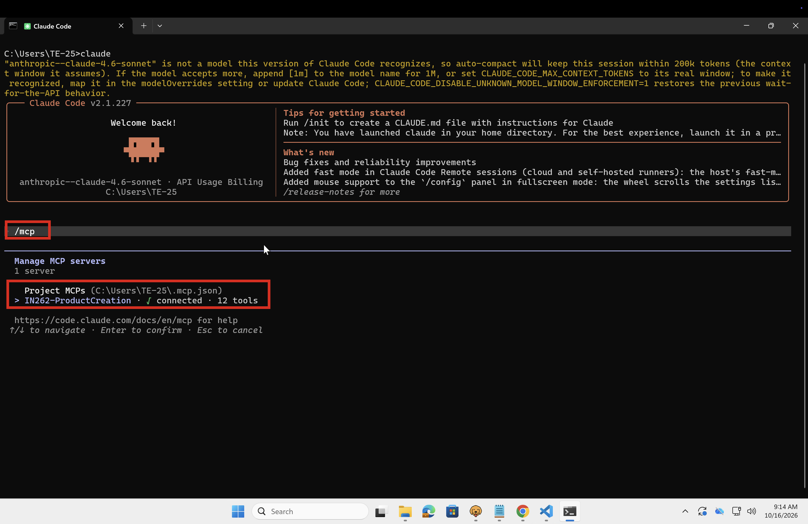

2. Confirm **IN262-ProductCreation** shows status **connected** and lists **12 tools**

> [!NOTE]
> If the server shows **disconnected**, verify your `.mcp.json` has the correct URL and a valid (non-expired) token, then restart Claude Code.

---

## Step 6 — Create a Product via the AI Agent

You will now act as the **Data Steward** — using natural language to instruct the AI agent to create a product in S/4HANA.

1. Type the following prompt, replacing `0XX` with your 3-digit participant number and `NN` with `01` for your first product, `02` for your second attempt, and so on:

> [!NOTE]
> **Example for participant 007, first attempt:**
> Product ID: `MZ-TG-ZAD01-IN262-00701` — Description: `Office Laptop IN262-00701`

```
Create a new product in S/4HANA with the following details:
- Product ID: MZ-TG-ZAD01-IN262-0XXNN
- Description: Office Laptop IN262-0XXNN
- Product Type: HAWA
- Industry Sector: M
- Base Unit: EA
- Language: EN
- Valuation Area (Plant): 1710
- Moving Average Price: 1000
- Currency: USD
- InventoryValuationProcedure: V
- ValuationClass: 3100
- PriceDeterminationControl: 2
- ProductSalesOrg: 1710
- ProductDistributionChnl: 10
- Item Category Group (MTPOS): NORM
```

   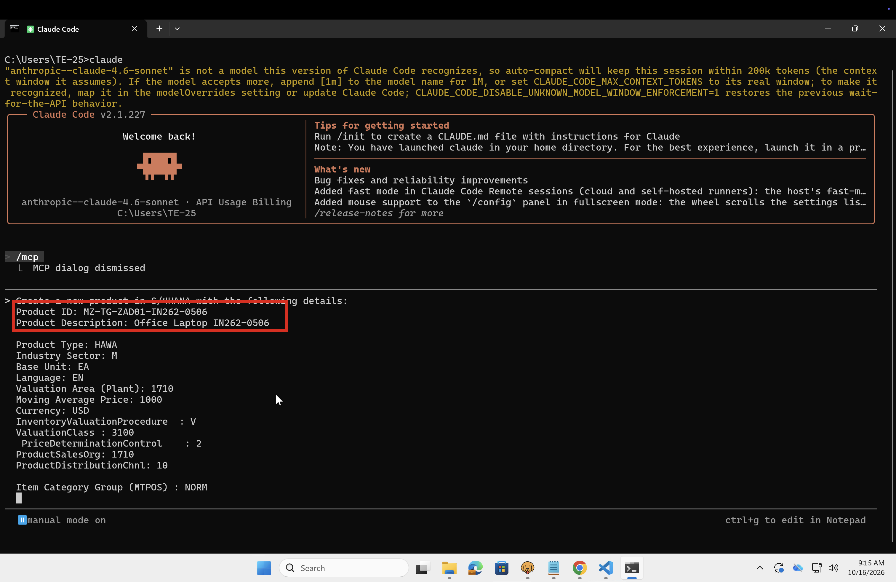

2. Claude Code processes the request

   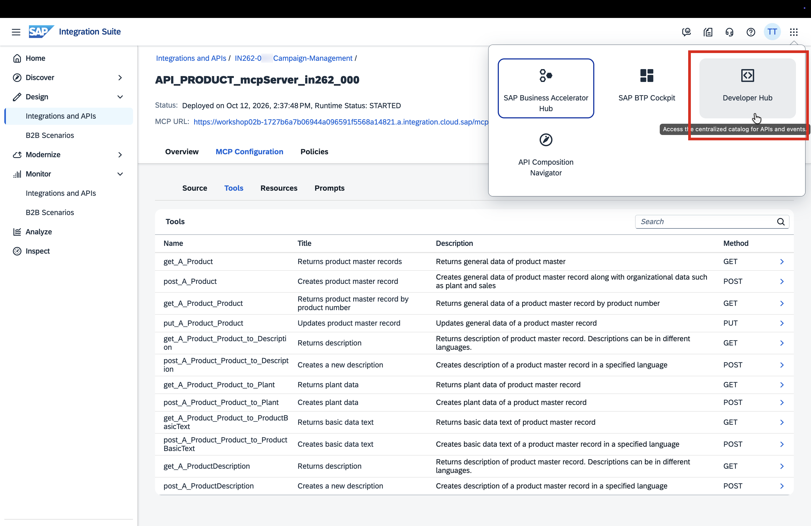

3. Claude Code asks for confirmation to call the MCP tool — click **Yes** (or **Yes, and don't ask again for this server**)

   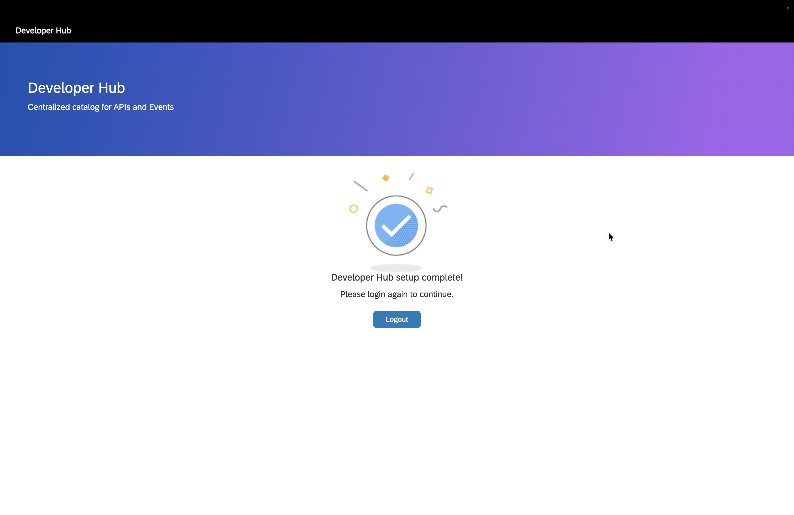

4. Claude Code calls the **IN262-ProductCreation** tool on your MCP server

   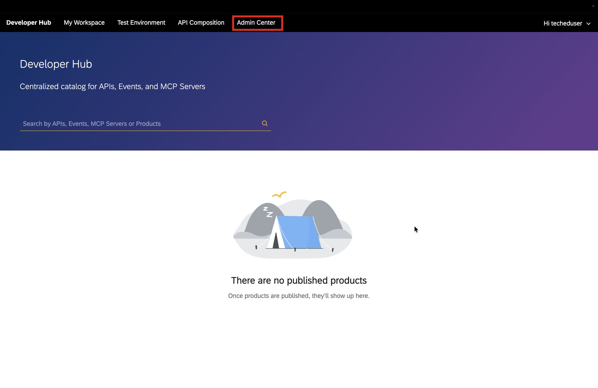

5. Claude Code confirms the product was created successfully — a summary table with all product fields is shown
> [!NOTE]
> The product creation triggers an AEM event in the background. The integration flow picks this up, calculates your personalised discount, and creates a campaign task in SAP Build Process Automation. This may take some seconds.

   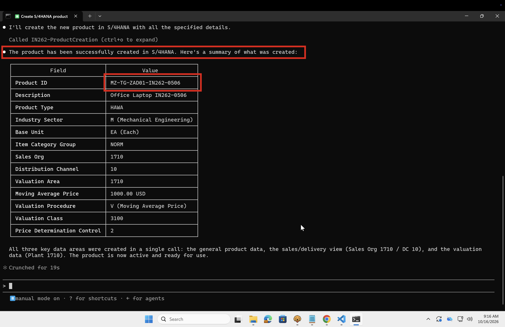


---

## Step 7 — Approve the Campaign Offer in My Inbox

You now switch roles — acting as the **End User / Customer** who receives the campaign offer.

1. Open your browser and navigate to the SBPA MyInbox:

   [My Inbox](https://url.sap/lf45f4)

2. Log in with your participant credentials (`in262-0NNN@education.cloud.sap`)

3. Click the **inbox icon** in the top navigation bar
   - Locate the task **Place Order - Product Offer** for your product
   - Review the offer details, confirm the quantity, and click **Place Order**

   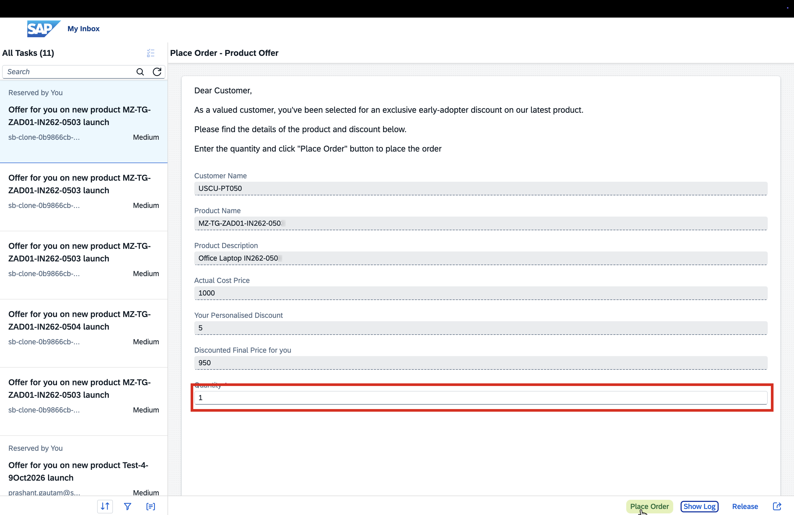

4. A **"Task processed successfully"** toast confirms the order was submitted

   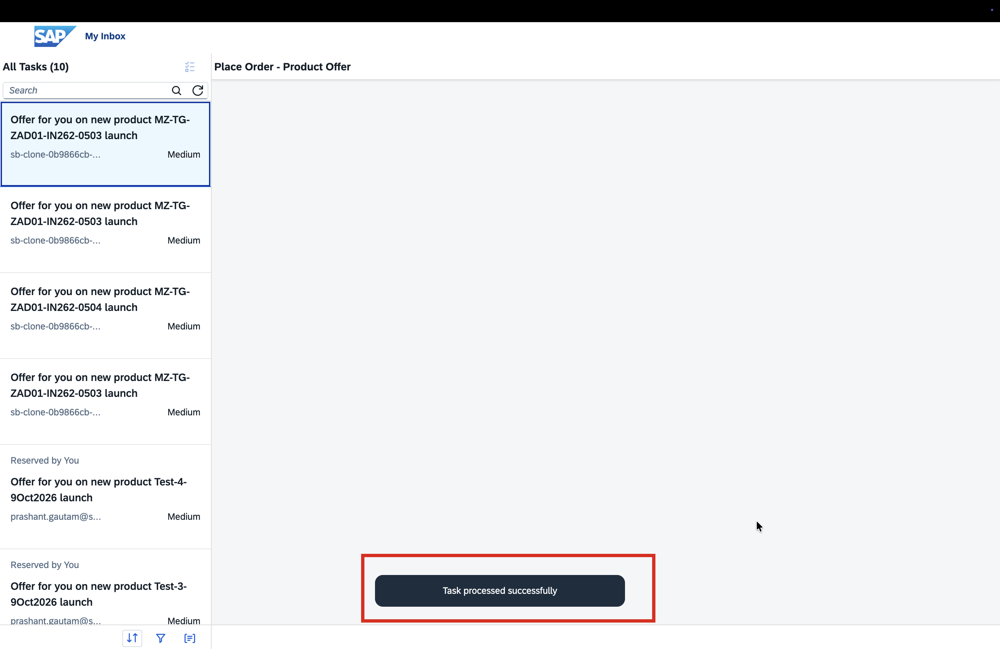

---

## Step 8 — Confirm the Sales Order
Once the order is created in the backend a notification will be sent back to you for order confirmation

1. Click the **inbox icon** again — you should now see a **"A Sales Order Created"** notification

   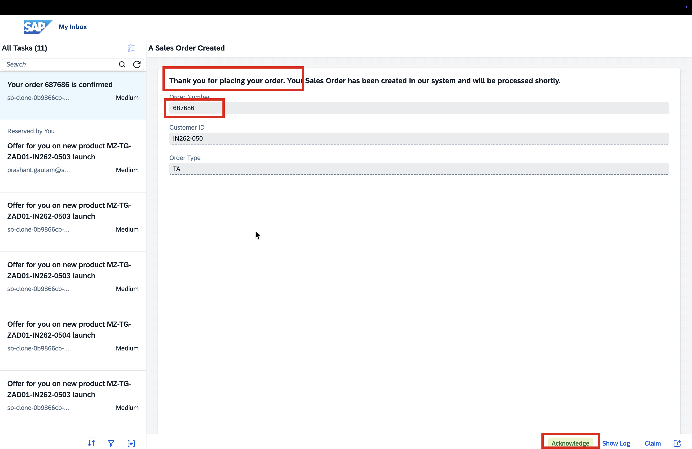

2. Note the **Sales Order number** assigned by S/4HANA — click **Acknowledge** to complete the flow

---

## Exercise 4 Complete

You have completed the full end-to-end journey:

1. Retrieved MCP server credentials from Developer Hub
2. Used Bruno to exchange credentials for an OAuth access token
3. Configured Claude Code CLI with your MCP server endpoint and token
4. Used an AI agent to create a product in S/4HANA — no API client, no manual payload
5. The integration platform picked up the event, calculated a personalised discount, and raised a campaign task
6. You placed the order and received the Sales Order confirmation

---

## Key Takeaway

This is AI-assisted integration in action: an AI agent bridged natural language to a governed enterprise API via MCP, while the integration platform handled the orchestration, enrichment, and business process automation in the background — without any manual intervention.

---

*[Back to overview](../../README.md)*
